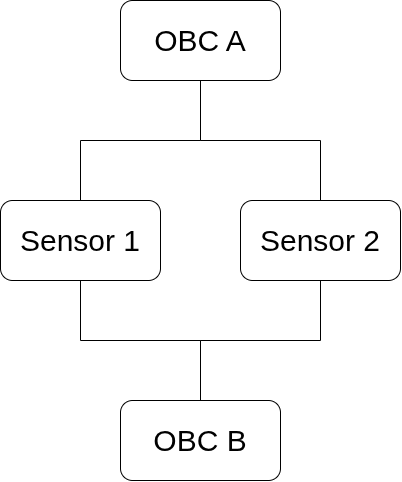
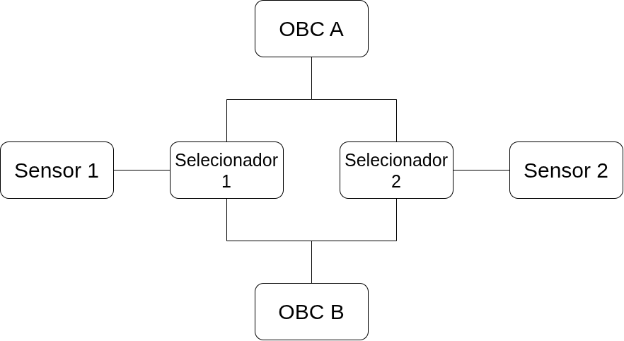
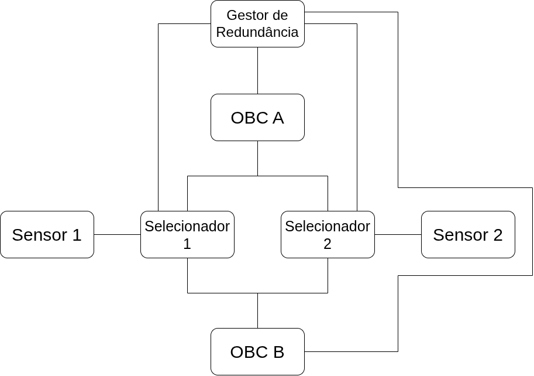
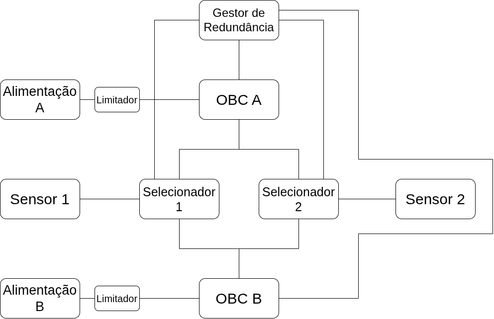

## Problema 1

Para produzir uma arquitetura que promove máxima segurança, é essencial minimizar o impacto de possíveis falhas em qualquer parte do processo de comunicação entre os OBCs e os sensores. Para tal, deveremos estabelecer ligações e componentes redundantes que possibilitem a sobrevivência do sistema, mesmo quando certos componentes percam a sua funcionalidade.
Assim sendo, conectaremos ambos os OBCs (A e B) a ambos os sensores (1 e 2). Desta forma, quer uma falha ocorra num OBC ou num sensor, haverá sempre uma ligação OBC-Sensor que continua estabelecida.

Contudo, se os dois OBCs tiverem acesso a um sensor ao mesmo tempo, poderão tentar comunicar com o sensor ao mesmo tempo e produzir um sinal inválido.
Teremos então de adicionar circuitos selecionadores (multiplexor, *bus switch*, etc.) que permitam controlar qual OBC terá acesso a um sensor num determinado instante.
Vale lembrar que é necessário escolher circuitos compatíveis com os protocolos SPI e I2C.
O protocolo I2C possui duas linhas SDA e SCL que são partilhadas por todos os dispositivos. Escolheremos multiplexadores próprios de I2C para encaminhar os sinais para o sensor correto.
Já o protocolo SPI utiliza quatro linhas: SCLK, CS, MOSI e MISO. É recomendado que o OBC que se encontra atualmente em stand-by seja isolado eletricamente do sistema. Por esta razão escolheremos interruptores analógicos.
A implementação destes dois protocolos de transferência de dados confere mais robustez ao nosso sistema: Podemos usar o protocolo SPI como meio principal da transferência, dado que é mais rápido, e, caso ocorra um erro com esse método, é-nos possível trocar para o protocolo I2C como meio de reserva.

Adicionaremos também um Gestor de Redundância para controlar qual OBC possui autoridade sobre os sensores.
Ele estará encarregue de manipular os selecionadores de modo a permitir que um OBC específico aceda ao sensor correto no instante correto.
Estará também ligado a ambos os OBCs para verificar se estes se encontram operacionais e para colocar um dos OBCs em baixo consumo.

Para melhor assegurar o bom funcionamento do sistema inteiro, será necessário introduzirmos Limitadores de Corrente.
Na ocorrência de um curto-circuito ou outra avaria elétrica semelhante, um limitador de corrente impede que um componente consuma toda a corrente e diminua drasticamente toda a tensão do sistema, desligando-o.
O limitador detetará esse aumento de corrente num componente e cortará rapidamente a sua alimentação, isolando a avaria e permitindo ao resto do sistema recuperar.
Separaremos também os ramos de alimentação do sistema para permitir o isolamento dos circuitos. A fonte de alimentação A fornecerá energia ao OBC A e a fonte de alimentação B fornecerá energia ao OBC B. Caso um dos limitadores de corrente dispare, garantimos que a linha oposta continua a ser alimentada apropriadamente.

Obtemos assim um sistema robusto e resistente a falhas, capaz de enfrentar as condições adversas do espaço. De acordo com o diagrama, o circuito consegue suportar falhas num dos OBCs, sensores e selecionadores, bem como numa das alimentações e manter a sua funcionalidade. Na verdade, apenas necessitamos de manter operacionais um OBC, a sua alimentação, um sensor, um circuito selecionador e o gestor de redundância para o sistema continuar a funcionar. Para além disso, é capaz de aguentar não só falhas de componentes, como também curtos-circuitos graças aos limitadores de corrente e erros de transferência de dados num dos protocolos devido à arquitetura que suporta ambos SPI e I2C.